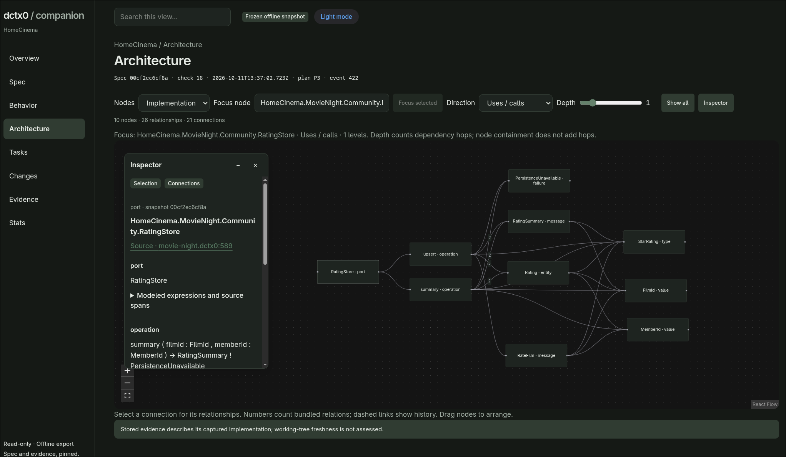

# DCTX0

**Make intent executable.**

An executable specification language for AI-native software development.

**Describe your product in plain language. Your coding agent writes and validates the specification with you. You review its rules and expected outcomes, then let agents implement the derived tasks.**

You can start without learning to author DCTX0 yourself. The contracts use familiar types, ranges, and given/when/expect examples so developers can read and discuss the behavior. The [agent-assisted guide](docs/site/src/docs/authoring.md) explains the workflow.

[Documentation website](https://haardt.github.io/dctx0ctl/) · [Get started](docs/site/src/docs/getting-started.md) · [Language reference](docs/site/src/docs/language.md) · [Tutorial](docs/site/src/docs/miniboard.md) · [Build the documentation site](docs/site/src/docs/contributing.md)

DCTX0 turns product requirements into a typed, machine-readable contract. That contract drives a dependency-aware task DAG, parallel implementation waves, and verification plans. Once an application exists, DCTX0 checks its actual behavior against the same specification.

People and coding agents develop the specification together. People own the product decisions; agents can write and refine the contracts, then implement them. An independent verification core assesses the observations.

> [!WARNING]
> **Experimental Project**
>
> This project is still experimental and has not been optimized for token efficiency.
> **Use at your own risk!**

## Why DCTX0?

Coding agents can write an implementation and its tests while misunderstanding the same requirement in both. Reviewing more generated code does not necessarily reveal that mismatch.

DCTX0 makes the expected behavior explicit before implementation begins. Data contracts define valid values. Examples describe concrete outcomes. Invariants express general rules. Lifecycles describe state transitions. Architecture intent and review criteria retain the requirements that need human or agent judgment.

The specification becomes a shared language for product owners, developers, and coding agents—and an executable reference for checking what gets built.

**Two central advantages: deterministic validation and coordinated parallel work.** The same contracts that define expected behavior also let DCTX0 derive focused implementation tasks, explain their dependencies, and identify which work can proceed independently.

## Who writes the specification?

**Your coding agent can write it with you.** Describe the product, discuss its rules and edge cases, and let the agent turn those decisions into DCTX0 contracts. The bundled language skill guides specification authoring and validation. You review the intended behavior and resolve open product questions before implementation begins.

At this stage, the agent can focus on the contract: data, operations, dependencies, valid states, and expected outcomes. The specification contains no application implementation. It can express behavior precisely without carrying algorithm bodies, database plumbing, or framework wiring into every discussion.

**The agent can devote its cognitive capacity to the specification.** Its reasoning effort goes into understanding the domain, connecting requirements, and identifying contradictions or missing decisions. Implementation details can wait until the contract is clear. This gives specification work a focused reasoning phase of its own.

Keeping implementation details separate can make room for more of the application's behavior in a limited context window. The agent can reason about relationships across the product before loading the implementation details of a particular task. A clear contract gives it fewer product decisions to guess and a concrete reference when it later writes code.

The same benefit applies to people. You can build an understanding of what the application does and review its rules without first reading all its implementation details. When a technical question matters, you can follow it into the relevant code. The specification provides the starting point.

Compilation catches invalid specifications; execution checks whether the application fulfills the modeled requirements. Examples, generated cases, and lifecycle checks help expose mistakes that plausible code alone can hide. Testing the agreed contract against the real implementation helps reduce errors, while keeping the tested scope and remaining gaps visible.

A consistently written specification can still encode a wrong product assumption. Review the meaning of its rules and examples; successful compilation does not establish that they describe the product you want. This workflow does not yet establish measured token savings.

The workflow is **understand the product → specify the contract → review the meaning → implement focused tasks → verify actual behavior**. Language and implementation skills support the agent through both specification and application work.

## From specification to parallel work

DCTX0 derives a **directed acyclic graph (DAG) of implementation tasks** from the validated specification. Each task carries its contract, acceptance criteria, and pinned specification context. Every hard prerequisite explains which result is needed and why, giving people and agents a concrete work plan.

The planner groups tasks into **dependency waves**:

- **The first wave has no open prerequisites** and can start immediately.
- **Tasks within a wave are independent in the prerequisite graph**, so multiple agents or developers can work on them in parallel, with shared-file changes coordinated separately.
- **Later tasks become ready when their own prerequisite results are delivered.** Waves describe dependency depth; unrelated unfinished work in an earlier wave does not impose a global barrier.

Atomic task claims prevent two workers from claiming the same task. A worker can also reserve a dependency-closed slice leading to a later task, then complete its prerequisites in order. DCTX0 supplies the required contracts and predecessor results on demand, so each worker can focus on its assignment while retaining the surrounding requirements.

This makes the specification useful for organizing implementation as well as checking it: it exposes parallel work, preserves dependency order, and gives every worker a shared contract. An external coding agent or team executes the tasks; DCTX0 provides planning, context, and guarded coordination.

```sh
dctx0 tasks plan <spec-root>
dctx0 tasks waves <spec-root>
dctx0 tasks claim-next <spec-root> --actor agent-1
dctx0 tasks claim-next <spec-root> --actor agent-2
```

Relevant specification changes create new adaptation tasks with explicit links to previous work. Historical results remain tied to their original requirements, and work completion stays separate from testing evidence: **Done does not imply PASS.** See the [task guide](docs/site/src/docs/workflow.md) for claims, slices, and change handling.

## A small example

These excerpts come from the [Cinema specification](examples/cinema/dctx0/movie-night.dctx0):

```dctx0
value ReleaseYear = Int {
  range 1888..2100
}
```

The value contract gives the verifier an explicit validity rule, including boundaries and invalid inputs.

Inside the `FilmCatalog` module, a behavioral example states what happens when a film is missing:

```dctx0
example "unknown film details" {
  given FilmCatalogStore.find(filmId) returns None
  when result = FilmCatalogApi.getFilm(filmId)
  expect result fails FilmNotFound
}
```

The surrounding specification declares the port, surface, and failure. A typed fixture supplies `filmId`. During verification, an external test adapter supplies the declared collaborator reply and invokes the real application operation. The central verifier assesses the observed result.

DCTX0 describes **what must hold**. Your application implements the algorithm, persistence, HTTP wiring, and framework integration in its own language.

## What you can do today

- **Compile specifications:** parse multiple files, compose fragments, resolve names, and check typed expressions and clauses.
- **Plan implementation work:** derive tasks, prerequisite waves, acceptance criteria, and pinned context with the required type closure.
- **Coordinate workers:** atomically claim individual tasks or dependency-closed work slices.
- **Verify real applications:** execute examples, generated contract cases, properties, operation checks, and lifecycle paths through native adapters.
- **Investigate failures:** retain observations and counterexamples, shrink supported failing inputs, and replay saved cases.
- **Track change:** compare contract, behavior, fact, and location changes; explain impact paths; record explicit renames.
- **Retain evidence:** store immutable verification runs and task history, with separate automatic results and source-bound inspections.
- **Work in your editor:** use the native language server, local VS Code/Zed extensions, and bundled coding-agent skills.

The CLI is written in Rust and runs independently. It does not invoke an LLM; an external coding agent uses its commands and skills.

### Native targets

| Target | Editable implementation profiles | Native verification | Complete Cinema example |
| --- | --- | --- | --- |
| TypeScript / Bun | Yes | Yes | [Cinema](examples/cinema/dctx0) |
| Go | Yes | Yes | [Cinema Go](examples/cinema-go) |
| Rust | Yes | Yes | [Cinema Rust](examples/cinema-rust) |
| Java | Yes | Not implemented | — |

The Rust core owns input generation, expectations, assessment, shrinking, and replay semantics. Target workers call actual application code and report observations; they do not assign their own PASS verdicts. Production applications remain independent of the DCTX0 runtime, with adapters kept in a separate testing area.

Managed native execution supports Linux x86_64/ARM64, macOS Intel/Apple Silicon and Windows x64 for TypeScript/Bun, Go and Rust. Linux retains process-tree supervision; macOS and Windows use bounded direct-child termination and waiting. Target-specific limits and supported representations are documented in the [TypeScript harness](docs/site/src/docs/typescript-adapters.md), [Go target](docs/site/src/docs/targets.md), and [Rust target](docs/site/src/docs/targets.md) guides.

## Quick start

Install the CLI, then [install the agent skills and draft a contract](#draft-a-contract-with-your-agent). You can ask your agent to handle syntax and validation while you review product decisions. The Cinema commands below provide a separate way to explore an existing application.

### Install a released binary

```sh
curl -fsSL https://github.com/Haardt/dctx0ctl/releases/latest/download/install.sh | bash
export PATH="$HOME/.local/bin:$PATH"
dctx0 --version
```

Supports **Linux x86_64/ARM64 (glibc 2.35+) and macOS Intel/Apple Silicon (14+)**. The installer verifies SHA-256 and the binary version, then installs atomically without sudo. It leaves shell profiles untouched. Run the script with **Bash**.

Pin a published release or choose another destination with `bash -s -- --version v0.1.1 --bin-dir /path/to/bin`. See [releases and installation](docs/site/src/docs/releases.md) for exact pinned URLs and manual downloads.

On **Windows x64**, run in PowerShell:

```powershell
irm https://github.com/Haardt/dctx0ctl/releases/latest/download/install.ps1 | iex
$env:PATH = "$env:LOCALAPPDATA\DCTX0\bin;$env:PATH"
dctx0 --version
```

The Windows installer checks the ZIP checksum and executable version before atomic replacement. The default destination is `%LOCALAPPDATA%\DCTX0\bin`; `-Version` and `-BinDir` provide pinned/custom installation. CLI, specification checks, task planning and LSP are available on all release platforms. **Managed native verification, replay and guarded automatic adoption are verified on all five release platforms** for TypeScript/Bun, Go and Rust. The native CI matrix exercises successful applications, real failures, repaired replay, task/review guards and Cinema persistence/HTTP.

### Install your application toolchains

Install the toolchains for your selected target yourself and make them available on `PATH` before native verification:

- **TypeScript:** Bun.
- **Go:** Go; the Cinema Go example requires Go 1.25+.
- **Rust:** Rust/Cargo and a C compiler for bundled SQLite. Use Xcode Command Line Tools on macOS and an MSVC developer environment with the Windows SDK on Windows.

Prepare your application's dependencies with its package manager, such as `bun install`, `go mod download`, or `cargo fetch`. The release installer installs DCTX0 only. Parsing specifications and planning tasks require only the DCTX0 binary.

### Build the CLI from source

Use a current stable Rust toolchain through rustup, Cargo, and a C toolchain for bundled SQLite. All four target features are enabled by default.

From the repository root:

```sh
cargo build --release -p dctx0-cli --locked
export PATH="$PWD/target/release:$PATH"
dctx0 --help
```

Alternatively, install the CLI from this checkout:

```sh
cargo install --path crates/dctx0-cli --locked
```

To build only a selected target:

```sh
cargo build --release -p dctx0-cli --no-default-features --features rust --locked
```

Parsing, compilation, and task planning do not require a native application toolchain. Verification additionally needs Bun for TypeScript, Go 1.25+ for Cinema Go, or Cargo and a C toolchain for Cinema Rust. Prepare native dependencies explicitly before managed execution. Python is used for repository validation scripts, not CLI product workflows.

### Draft a contract with your agent

Install the bundled skills in your application project:

```sh
dctx0 install --project /path/to/app --agent codex,claude
```

Open your coding agent in that project and give it a request like this:

> Use the dctx0-language skill to draft a specification under dctx0/ for a film catalog. Films have a title and a release year from 1888 through 2100. Users can retrieve a film by ID; an unknown ID must return FilmNotFound. Ask me about unresolved product rules instead of choosing silently. Validate the specification with dctx0 check, explain its rules and examples in plain language, and wait for my review before implementation.

Review the generated contract alongside the explanation. For example, `range 1888..2100` makes the year boundaries visible, and the missing-film example above describes the expected failure. Ask the agent to correct any rule that differs from your intent. Once you agree on the behavior, ask it to plan the tasks and use the `dctx0-implementation` skill to implement them and connect a testing adapter to the real application.

DCTX0 supplies contracts, task context, and verification commands. Your external coding agent performs the work. See [author with your agent](docs/site/src/docs/authoring.md) for a walkthrough.

### Explore the specification and tasks

To try the example applications, clone the repository and run the following commands from its root:

```sh
git clone https://github.com/Haardt/dctx0ctl.git
cd dctx0ctl
```

```sh
dctx0 check examples/cinema/dctx0
dctx0 tasks preview examples/cinema/dctx0
dctx0 tasks plan examples/cinema/dctx0
dctx0 tasks waves examples/cinema/dctx0
dctx0 tasks next examples/cinema/dctx0
```

`check` compiles and publishes a valid snapshot. `tasks preview` shows proposed work; `tasks plan` publishes it. Read queries describe saved, pinned requirements rather than asserting working-tree freshness.

### Run the TypeScript application checks

The reference Cinema project already contains an adapter, fixtures, configured verification scope, and authored inspection notes.

```sh
bun install --frozen-lockfile --cwd examples/cinema

dctx0 verify plan examples/cinema/dctx0 --project examples/cinema
dctx0 verify run examples/cinema/dctx0 --project examples/cinema --no-adopt
```

`plan` projects requirements without executing the application. `run` executes the configured finite plan and stores evidence. `--no-adopt` keeps task progress unchanged.

For complete configured acceptance:

```sh
dctx0 verify complete examples/cinema/dctx0 --project examples/cinema --json
```

This checks the specification, publishes the current task plan, executes the configured native scope, binds existing authored inspections, and requires a nonempty delivered active plan with appropriate testing or source-bound review evidence. Approved Review tasks may remain Done/Unverified and are reported separately; approval never sets testing PASS. It does not generate review approvals. See [complete acceptance](docs/site/src/docs/agent-evidence.md).

### Try Go or Rust

```sh
go -C examples/cinema-go mod download
dctx0 verify complete examples/cinema-go/dctx0 --project examples/cinema-go --json
```

```sh
cargo fetch --manifest-path examples/cinema-rust/.dctx0/testing/rust/Cargo.toml --locked
dctx0 verify complete examples/cinema-rust/dctx0 --project examples/cinema-rust --json
```

The applications use the same Cinema specification and central semantic verification plan. Go and Rust compile testing workers through managed native builds, with compiler inputs and worker executables recorded separately from central assessment.

## Learn the language

The [MiniBoard tutorial](examples/tutorial/README.md) introduces the language through 16 cumulative TypeScript applications, with independent production tests and external verification adapters. The final step creates and completes actual tasks.

To open the final application, install its dependencies and start it:

```sh
cd examples/tutorial-step-16-http-replay
bun install --frozen-lockfile
bun run start
```

Open <http://127.0.0.1:4173/>. To give an agent a fresh exercise while retaining the reference solutions, run from the repository root:

```sh
./examples/tutorial/agent-step.sh 1 -- codex exec --full-auto
```

## Use DCTX0 in your own project

Keep the reviewed specification root separate from the application root. Start by compiling the specification, then publish implementation guidance and tasks:

```sh
dctx0 check /path/to/app/dctx0
dctx0 profile typescript create --project /path/to/app --default --agents
dctx0 tasks plan /path/to/app/dctx0
dctx0 tasks show /path/to/app/dctx0 T42 --target typescript
```

`T42` is an example task ID; use one returned by your task plan. Profiles are editable Markdown under `.dctx0/profiles`. They guide implementation without changing language semantics. Used profiles are frozen with claims and reservations; free-form notes are not automatically verified properties.

See [Configure and extend profiles](docs/site/src/docs/profiles.md) for the difference between shared, implement, and use guidance, configuring a project, and editing the shipped defaults in a DCTX0 checkout.

For Go/Gin or Rust/Axum agent guidance, merge the optional framework presets into your local profiles. This is a Markdown choice, not a `--framework` CLI flag. A reviewed project adapter must separately connect the real production router. Existing Cinema HTTP defaults remain available alongside the framework variants. See [HTTP framework profiles and harness setup](docs/site/src/docs/http-frameworks.md).

Inspect structural candidates and initialize a testing adapter:

```sh
dctx0 verify discover /path/to/app/dctx0 --project /path/to/app --target typescript
dctx0 verify init /path/to/app/dctx0 --project /path/to/app --target typescript
```

`discover` reports unconfirmed structural candidates. `init` preserves existing files and creates an explicitly unavailable adapter scaffold. Implement the adapter against real application entry points and supply the observations required by your contracts.

Technical configuration lives in `.dctx0/testing/verification.json`: target, runtime, adapter, fixtures, explicit scope, seed, and budgets. An empty scope does not select the entire application. The default generated-case budget is 100 per obligation; explicit examples remain mandatory. Changed specification sources require a successful `check` before ordinary verification.

Native TypeScript dependency resolution has a separate reference budget: `"dependency_resolution": { "max_references": 10000 }`. The default is 10,000, including when the field is omitted; valid integer limits are 1 through 1,000,000. Every literal reference counts, including repeated references, cached answers, builtins and unsuccessful resolutions. `DEPENDENCY_RESOLUTION_BUDGET` retains the resolved prefix, marks provenance incomplete and blocks automatic task adoption. Effective limits are saved as evidence; replay uses current configuration and reports limit changes. See [TypeScript configuration](docs/site/src/docs/typescript-adapters.md#native-dependency-budget).


Prepared collaborator replies test consumer behavior under controlled conditions. Actual persistence and HTTP integration need real native checks and observers. See [verification setup](docs/site/src/docs/workflow.md), [planning](docs/site/src/docs/workflow.md), and the target guides for capability boundaries.

## Understand the evidence

| Result | Meaning |
| --- | --- |
| `PASS` | The selected mandatory finite-plan requirements are satisfied. |
| `FAIL` | A check found a concrete violation. |
| `UNKNOWN` | A required statement lacks sufficient evidence. |

Finite testing does not prove correctness for every possible input. Missing observers, unsupported constructs, incomplete provenance, and unexecuted mandatory checks remain visible. Opaque trace labels remain unmodeled; they do not establish resolved dependencies or prove runtime calls.

Work progress (`Open`, `Progress`, `Done`) is separate from testing status (`Unverified`, `PASS`, `FAIL`). **Done does not imply PASS.**

Without `--no-adopt`, a native run may deliver eligible open, unclaimed, unreserved tasks when complete task-specific evidence and transactional guards permit it. Historical results, running work, reviews, and incomplete requirements retain their protections. Imported PASS reports alone cannot authorize native adoption.

Saved evidence can be inspected or replayed:

```sh
dctx0 verify show <spec-root> <run-id> --json
dctx0 verify replay <spec-root> <run-id> --case <case-id> --project <app-root>
```

Replay executes saved inputs as a new comparison and never adopts tasks. Saved reports preserve their original provenance; they do not assert that today's working tree is unchanged.

Narrative requirements, named suites, and reviews can receive explicit source-bound inspections:

```sh
dctx0 verify inspect <spec-root> <run-id> --project <app-root> --file <inspections.json>
dctx0 verify attest <spec-root> <run-id> --project <app-root> --file <task-reports.json>
```

`inspect` publishes an effective program assessment without new execution or task adoption. `attest` delivers eligible inspected task reports through guarded transitions. Automatic and inspection evidence remain separate, and approval cannot override an actual automatic FAIL. Source changes invalidate the relevant bindings. See [verification history](docs/site/src/docs/evidence.md) and [inspection delivery](docs/site/src/docs/agent-evidence.md).

### Cinema acceptance

The documented complete TypeScript, Go, and Rust Cinema acceptances each cover **5,674 mandatory finite cases**. Current planning assigns 25 manual/suite obligations to four Review tasks; a fresh Cinema plan has **105 tasks**. Source-bound reviews are reported separately from testing PASS. Actual persistence and HTTP checks, deliberate production mutations, and broken/repaired replay exercise the implementation and its wiring.

Native reports retain unresolved manual/suite obligations. Authored source-bound inspections produce a separate effective assessment. These results establish the documented Cinema scope, not unrestricted proof for arbitrary applications.

Evidence: TypeScript (historical evidence removed during repository cleanup), Go (historical evidence removed during repository cleanup), Rust (historical evidence removed during repository cleanup).

## Track changes and coordinate work

```sh
dctx0 parse <spec-root>
dctx0 history <spec-root> --json
dctx0 diff <spec-root> <before-snapshot> latest --json
dctx0 impact <spec-root> <qualified-symbol> --snapshot latest --json
dctx0 rename <spec-root> <qualified-symbol> <new-name> --dry-run --json
```

`parse` also accepts a single file. Snapshot selectors accept `latest`, a full hash, or an unambiguous hexadecimal prefix of at least eight characters. `--json` supplies structured output; task commands default to Markdown. Global `--db <path>` selects another SQLite database.

Specs remain source files. Derived history defaults to `<spec-root>/.dctx0ctl/state.sqlite3`. Successful checks publish transactionally; failed compilation preserves the last valid head. Semantic cycles are supported, while task prerequisites form a separate DAG.

Changed requirements create new adaptation tasks with explicit predecessor links. Historical Done/PASS tasks remain evidence for their old requirements. Explicit renames record continuity; ordinary remove/add edits do not infer identity from similarity. Rename covers declarations and scoped descendants; fields, parameters, and enum alternatives require dedicated future operations. Dry runs write neither sources nor history. Real renames use a project lock and recovery journal for coordinated multi-file updates.

For worker coordination, use `tasks claim-next` or `tasks claim-slice` with an actor. Transitions require the returned claim/reservation and version guards. Context includes required types and acceptance criteria; large contexts expose missing sections and pinned continuation cursors. See [tasks](docs/site/src/docs/workflow.md) and [profiles](docs/site/src/docs/profiles.md).

## Agent skills and editors

The CLI bundles three complementary skills:

| Skill | Purpose |
| --- | --- |
| [`dctx0`](skills/dctx0/SKILL.md) | Navigate the workflow, select work, and interpret verification evidence. |
| [`dctx0-language`](skills/dctx0-language/SKILL.md) | Author, review, and repair specifications, including typed contracts, examples, and lifecycles. |
| [`dctx0-implementation`](skills/dctx0-implementation/SKILL.md) | Implement and repair application tasks and testing adapters using pinned requirements and native verification. |

Install them for your coding agent:

```sh
dctx0 skills list
dctx0 install --project /path/to/app --agent codex,claude
```

Use `--dry-run` to preview. Existing differing content is preserved unless you explicitly use `--force`. Global installation is available with `--global`. See [agent skills](docs/site/src/docs/tools.md).

The native language server supports diagnostics, completion, hover, navigation, symbols, and semantic colors, including unsaved multi-file edits:

```sh
dctx0 lsp --stdio
dctx0 editor install vscode --output "$HOME/dctx0-editors" --activate
dctx0 editor install zed --output "$HOME/dctx0-editors"
```

VS Code activation invokes the `code` CLI. For Zed, select the generated directory through **zed: install dev extension**. These are local extension packages. See [editor setup](docs/site/src/docs/tools.md).

## Architecture

Dependencies point toward the language-neutral core. AST and validated IR remain separate; targets consume validated semantics. Filesystem and process effects belong to adapters.

| Crate / directory | Responsibility |
| --- | --- |
| `dctx0-core` | AST, validated IR, values, diagnostics, shared contracts |
| `dctx0-language` | Lexer, parser, composition, resolution, type checking |
| `dctx0-interpreter` | Pure budgeted expression evaluation |
| `dctx0-verification` | Deterministic corpora, plans, scenarios, assessment, shrinking |
| `dctx0-target-sdk` | Versioned transport and testing-artifact contracts |
| `dctx0-graph` | Semantic dependencies, cycles, governing facts, impact paths |
| `dctx0-changes` | Fingerprints, snapshot diffs, history ports, rename lineage |
| `dctx0-tasks` | Pure planning, prerequisite DAG, reconciliation, context, slices |
| `dctx0-store` | Transactional SQLite snapshots, task events, verification history |
| `dctx0-engine` | Source I/O, publication, locking, native orchestration, recovery |
| `dctx0-lsp` | Language service and LSP transport |
| `dctx0-cli` | Commands, rendering, target registration, benchmark drivers |
| `targets/{typescript,go,rust,java}` | Target profiles and available native implementations |

Compilation follows sorted source discovery → parsing → composition and resolution → type checking → validated IR → semantic graph → fingerprints and snapshot publication. Diagnostics retain source files, codes, and positions.

Native execution uses bounded processes with timeouts, cancellation, output limits, and cleanup. On Linux, an available systemd user scope can cap collective memory at two thirds of startup available RAM, with swap disabled. `DCTX0_MEMORY_GUARD=0` disables this optional cap; unavailable support is reported explicitly. This is resource management, not a security sandbox. See [managed execution](docs/site/src/docs/evidence.md), [verification architecture](docs/site/src/docs/contributing.md), and [compiler boundaries](docs/site/src/docs/contributing.md).

## Development and validation

Repository validation requires Python 3, Linux for performance measurement, the Rust coverage tools, and the native target toolchains. CI currently uses Bun 1.4.2, Go selected by the Cinema module, and stable Rust. Consult [.github/workflows/validate.yml](.github/workflows/validate.yml) for the full environment and tutorial/browser checks.

```sh
rustup component add rustfmt clippy llvm-tools-preview
cargo install cargo-llvm-cov --locked
python3 scripts/validate.py --coverage
```

The project runner couples functional validation with release speed and RAM measurements. It runs the relevant workspace/feature checks, formatting, Clippy with warnings denied, tests, native checks, and coverage. Rust production-code coverage must meet **97% merged source lines and 97% LLVM functions**. Raw LLVM metrics and native helper coverage remain separate; line coverage does not establish branch completeness.

Benchmarks use uninstrumented release builds and retain elapsed milliseconds, peak RSS bytes, raw samples, workload identity, input/source hashes, toolchains, cache conditions, and environment provenance. Rust core costs and native build/execution costs are reported separately. Core RSS is Linux post-exec `VmHWM`, including phase preparation; native workloads record their own memory scope. Unsupported measurement is explicit.

The latest 20 runs are retained under `benchmarks/history/`. The accepted baseline lives separately in `benchmarks/baseline.json`. Comparable regressions above **20% runtime** or **10% RAM** fail the performance gate. Missing or incompatible baselines are reported as unassessed. Configure tolerances with `--speed-tolerance` and `--ram-tolerance`.

Baseline promotion is an intentional review step, never automatic:

```sh
python3 scripts/validate.py --accept-baseline latest
# Or select a retained run:
python3 scripts/validate.py --accept-baseline <recorded-filename.json>
```

Dependency-resolution acceptance is included at the end of the coupled validation runner. To repeat its release measurements independently, build with `cargo build --release -p dctx0-cli --all-features --locked`, then run `python3 scripts/dependency_resolution_acceptance.py --binary target/release/dctx0`. It exercises a real 1,200-file chain with a cycle, repeated references, and a small-budget stop with one warmup and three samples each. Latest-20 reports live in `benchmarks/history/dependency-resolution/`; new workloads are unassessed against a baseline. Reports separate sampled direct-engine RSS from worker VmHWM and explicitly label command/descendant RSS and sampling limits.

Reduced samples (`--samples 1 --iterations 1`) and `--skip-performance` are development options. Deferred or partial validation does not pass final performance/coverage acceptance. See [coverage](docs/site/src/docs/contributing.md) for measured scope and limitations.

## Releases

Pushing a version tag such as `v0.2.2` creates a GitHub Release after full validation and all five native distribution jobs pass. For v0.2.0, v0.2.1 and v0.2.2, CI validation and distribution tests are explicitly skipped at the maintainer’s request; native builds and packaging remain required. This exception does not disable validation for future releases. The tag must match `[workspace.package].version` and the committed lockfile. Prereleases are marked explicitly and do not replace the installer's latest stable release.

```sh
git tag -a v0.1.1 -m "DCTX0 v0.1.1"
git push origin v0.1.1
```

The [release workflow](.github/workflows/release.yml) publishes Linux x86_64/ARM64 and macOS Intel/Apple Silicon archives, a Windows x64 ZIP, `install.sh`, `install.ps1`, and `SHA256SUMS`. [The maintainer guide](docs/site/src/docs/releases.md) documents release provenance and coupled installer/performance validation.

## Documentation site

The product landing page and English user guide use **mdBook**, a Rust documentation generator. Build and validate the static GitHub Pages artifact with:

```sh
python3 scripts/install_mdbook.py
python3 scripts/docs_site.py --dctx0 target/release/dctx0
```

Build the release CLI first using the quick-start instructions. The runner checks local links and complete DSL examples, then records release site-build speed/RSS. Output is `target/docs-site`; use `target/docs-tools/mdbook serve docs/site --port 4180` for a local preview.

[Publishing and maintenance](docs/site/src/docs/contributing.md) explains the GitHub Actions workflow, Pages setup, and source layout.

## Documentation

| Guide | Topic |
| --- | --- |
| [Tutorial](examples/tutorial/README.md) | Learn the language through working applications |
| [Task guide](docs/site/src/docs/workflow.md) | Planning, context, claims, slices, history |
| [Profiles](docs/site/src/docs/profiles.md) | Editable implementation guidance |
| [Verification planning](docs/site/src/docs/workflow.md) | Scope, fixtures, mandatory requirements |
| [Run and replay](docs/site/src/docs/evidence.md) | Native observations, counterexamples, adoption |
| [Complete acceptance](docs/site/src/docs/agent-evidence.md) | Authored inspections and task completeness |
| [Go target](docs/site/src/docs/targets.md) / [Rust target](docs/site/src/docs/targets.md) | Native setup, provenance, capability limits |
| [Static Site and Task Live View](docs/site/src/docs/site-companion.md) | Project export, architecture focus, floating Inspector, live tasks |
| [Skills](docs/site/src/docs/tools.md) / [Editors](docs/site/src/docs/tools.md) | Agent and editor integration |

Capability descriptions reflect the Rust workspace as of October 16, 2026. DCTX0 is under active development; production-code generation and native Java execution remain future work.

## License

[MIT](LICENSE).

## DCTX0 self-specification

The [product specification](dctx0/README.md) describes DCTX0 itself, with compiler
and evidence examples plus executable contracts for tasks, history, profiles, native
execution, editors and distribution. The testing-only Rust adapter exercises the
actual implementations through an isolated captured build. See the
[self-verification guide](docs/site/src/docs/self-verification.md) for scope and limits.

Rust self-verification from this checkout:

```sh
cargo build -p dctx0-cli --all-features --locked
./target/debug/dctx0 verify self . --json
python3 scripts/self_verification_acceptance.py --checks --mutations
```

The coupled runner performs affected regressions and production mutation checks,
then release speed/RSS measurements. Linux, rustup Cargo/Rust and the SQLite host
C compiler are required. Reports retain partial scope and separate source-bound
reviews; they never adopt the development project's tasks. See
[the self-verification guide](docs/site/src/docs/self-verification.md).

## Static Site and Task Live View

Generate a read-only React companion for **any dctx0 project**, independently of
its implementation language or framework. Cinema is an example, not a special
mode. The project needs a valid published specification in its history database:

```sh
# Replace this path with your project's specification directory.
dctx0 check path/to/project/dctx0

# Optional: create a task plan to populate the Tasks view.
dctx0 tasks plan path/to/project/dctx0

# Choose an offline export or a local live view.
dctx0 site export path/to/project/dctx0 --output target/project-site
dctx0 site serve path/to/project/dctx0
```

**Static Site:** open `target/project-site/index.html` directly under `file://`,
or host the export as a static website. The HTML embeds its assets and captured
data; browsing needs no runtime server, network, Bun or Node.

**Task Live View:** follow the loopback URL printed by `site serve`. Task starts,
completions and newly stored evidence appear on a three-second refresh while the
tab is visible. Selection, filters, scroll and graph positions are preserved.
The UI reads changes made through the CLI; it does not execute or edit tasks.
Missing task plans or verification runs appear as empty sections.

The views cover Overview, Spec, Behavior, Architecture, Tasks, Changes, Evidence
and Stats. Architecture offers:

- **Implementation / All spec nodes:** keep surfaces, ports, operations and types
  visible, or include examples, tests and reviews.
- **Searchable focus and depth slider:** inspect children, outgoing Uses / calls,
  incoming Used / called by, or Both directions. Operations retain their owning
  surface/port as context. Focus and filters are linkable through hash URLs.
- **Floating Inspector:** node and connection details stay above the graph in a
  narrow panel. Drag its header or use arrow keys; minimize or close it while
  continuing to pan, zoom and arrange nodes. Its contents scroll internally.

Tasks open in **Waves** by default. Clicking a task in Waves, List or DAG opens
its assignment, acceptance, results and history in a **Markdown-oriented dialog**;
DCTX0 contracts remain exact code blocks, with JSON available as technical detail.
The DAG offers searchable task focus, a depth slider, **Prerequisites**,
**Dependents**, and **Both directions**. Closing the dialog preserves graph focus;
historical links remain separate. Filter labels sit above their controls.
Light and dark modes are available.



Cinema example:

```sh
dctx0 site export examples/cinema/dctx0 --output target/cinema-site
dctx0 site serve examples/cinema/dctx0
```

Site commands never create or migrate a database or compile the specification.
Run `check` explicitly when publishing new requirements. Both commands honor
global `--db`; export also supports `--snapshot`, `--plan` and `--as-of`.
Live mode accepts `--port` and stops on Ctrl-C. Stored evidence describes its
captured implementation, not the current working tree; Done and PASS remain
separate. See the [Static Site and Task Live View guide](docs/site/src/docs/site-companion.md).

Contributor assets: `bun install --frozen-lockfile --cwd ui/site`,
`bun run --cwd ui/site check`, `bun run --cwd ui/site build`, then
`bun run --cwd ui/site verify-assets`. Users of the Rust CLI need no Bun or Node.
Run `python3 scripts/site_acceptance.py` for coupled Rust/UI/Chromium acceptance
and release speed/RSS measurements; Chromium must be locally installed. Run
`python3 scripts/validate.py --coverage` for required full-workspace validation.
See [site capability and provenance details](docs/site/src/docs/site-companion.md).

Native portability acceptance: build the
all-feature release CLI, then run
`python scripts/native_portability.py --binary target/release/dctx0 --coverage`
(`dctx0.exe` on Windows). This pairs transport/target/Cinema checks with release
time and peak-memory measurements; see
[scope and evidence](docs/native-portability-validation.md). Native CI requires
Bun, Go, Rust and the host C toolchain, with a Visual Studio developer environment
on Windows. Existing source-bound reviews must still match their source bytes.
